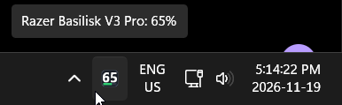
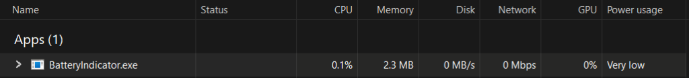

# Battery Indicator App

A tiny, lightweight Windows system tray utility written in C++20 / Win32 that shows battery levels for connected wireless peripherals right in the taskbar tray.



## Why?

I got tired of keeping multiple bloated OEM companion apps running in the background just to check the battery percentage on my mouse, controller, or headset. This replaces them with a single small standalone executable (~2–4 MB RAM, zero external dependencies) that sits quietly in the system tray.



> **Note:** Wireless peripherals report battery status in many different (and often proprietary) ways. While this works with standard Bluetooth, XInput, HID battery reports, and select 2.4 GHz wireless dongles, **there is no guarantee it will work with every device**.

## Features

- **Supported Devices**: Bluetooth & BLE peripherals, XInput wireless controllers, standard HID battery devices, select 2.4 GHz dongles, and optional system/laptop battery.
- **Auto-Refresh**: Updates automatically when devices connect or disconnect, plus a configurable polling interval.
- **Customizable Tray Icons**: 5 indicator styles (rings, bars, device glyphs, or percentage text), 4 icon sizes, single or per-device tray icons, and an optional "Launch on Windows Startup" toggle.

## Building & Running

Requires **Visual Studio** or **Visual Studio Build Tools** (Desktop development with C++).

```bat
build.bat
```

Run `BatteryIndicator.exe` and click the tray icon to view battery levels or open **Settings**. Preferences are saved to `settings.ini` next to the executable.

## AI Disclosure

Generative AI was used to help plan, partly implement, and debug.

## License

[MIT](LICENSE)
